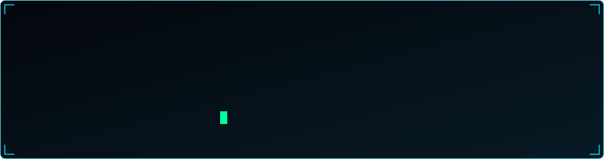
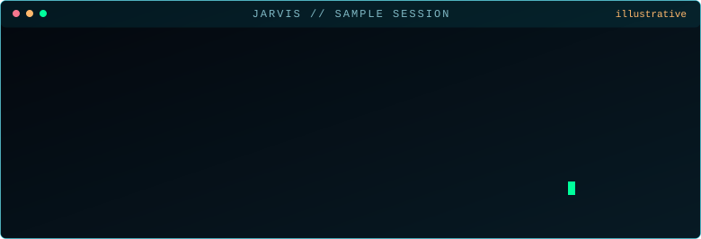
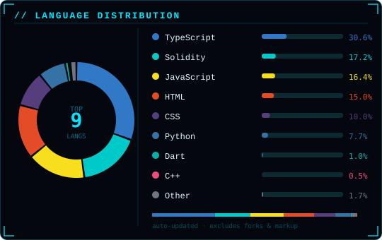

<div align="center">
  
</div>

<div align="center">
  
</div>

<br/>

<div align="center">

[](mailto:motsieashley31@gmail.com)
[](https://www.linkedin.com/in/ashley-k-motsie-718686263/)
[](https://ashleydevhub.vercel.app/)
[](https://www.youtube.com/@Ashley.Programmer)

[](https://user-badge.committers.top/south_africa/KodEx-SA)


</div>

<div align="center"></div>

## `[ SYSTEM STATUS ]`

```yaml
operator:    Ashley K Motsie
callsign:    KodEx-SA
class:       Software Developer / AI Engineer
location:    Rustenburg, ZA   # SAST (UTC+2)
status:      ONLINE
availability:
  full_time_remote:  OPEN
  freelance:         ACTIVE
response_time:  < 24h
current_focus:
  - Jarvis        # agentic assistant, in progress
  - Learning C    # from the ground up
side_channels:
  - poetry
```

I build full-stack web apps and AI-powered systems: voice assistants, chatbots, network infrastructure and Web3 tools. Most of what I ship is self-taught and production-facing, not just side projects. I've completed contracts at two tech firms, I'm freelancing now, and I'm looking for a remote full-time role where I can keep building things that actually work.

> 🟢 **Open to full-time remote opportunities.**

<div align="center"></div>

## `[ MISSION LOG ]`

<div align="center">
<table>

<tr>
<td width="18%" align="center"><b>Jul 2025<br/>– May 2026</b></td>
<td>

**Software Developer & AI Engineer** · AI Global Networks
<br/>
<sub>Consulted on the AGN site (Groq-powered chatbot, Google Calendar booking integration) and built `webaudit`, a Playwright-based CLI auditing tool.</sub>
<br/><br/>


</td>
</tr>

<tr><td colspan="2"><div align="center"></div></td></tr>

<tr>
<td width="18%" align="center"><b>Jun 2025<br/>– May 2026</b></td>
<td>

**Jr Software Developer & IT Technician** · Eullafied Tech Solutions
<br/>
<sub>Shipped the ETS WiFi Captive Portal (Node.js/Express/SQLite, AES-256-GCM, JWT) and the Intern Management System monorepo, end to end.</sub>
<br/><br/>


</td>
</tr>

<tr><td colspan="2"><div align="center"></div></td></tr>

<tr>
<td width="18%" align="center"><b>Ongoing</b></td>
<td>

**Web Developer & Graphic Designer** · Maps Media Productions
<br/>
<sub>Web development and graphic design across client sites and campaigns.</sub>
<br/><br/>


</td>
</tr>

</table>
</div>

<div align="center"></div>

## `[ DEPLOYED AGENTS & SYSTEMS ]`

<div align="center">
<table>
<tr>

<td width="33%" align="center">


<br/><br/>
<b>Clare · AI Voice Assistant</b>
<br/><br/>
<sub>
A full voice-AI pipeline with persistent memory and a live Mission Control Dashboard. Runs on a free-tier provider stack - Deepgram STT, Groq LLM, Cartesia TTS, Silero VAD - backed by Supabase.
</sub>
<br/><br/>


</td>

<td width="33%" align="center">


<br/><br/>
<b>Trading-R1 Trace Market</b>
<br/><br/>
<sub>
A reasoning-trace marketplace built for the Agora Agents Hackathon. Two Solidity contracts deployed on Arc Testnet, a Next.js 15 frontend with wagmi/RainbowKit, and a Python agent pipeline on Groq + Pinata.
</sub>
<br/><br/>


</td>

<td width="33%" align="center">


<br/><br/>
<b>Driver Drowsiness & Fatigue Monitor</b>
<br/><br/>
<sub>
A computer-vision safety system tracking eye closure, yawns, and gaze to compute a real-time fatigue score and trigger high-risk alerts. Includes a dashboard for logging events and exporting driving data.
</sub>
<br/><br/>


</td>

</tr>

<tr>

<td colspan="3" align="center">


<br/><br/>
<b>Jarvis · Agentic Personal Assistant</b>
<br/><br/>
<sub>
A fully agentic assistant for Linux that acts on its own or on command, not just chat. Voice interface, web browsing, Gmail/Google Calendar and Outlook support, coding help, app control and reminders, running on cloud LLMs (Claude, Groq) with a local fallback.
</sub>
<br/><br/>


</td>

</tr>
</table>
</div>

<div align="center"></div>

## `[ AGENT ARCHITECTURE ]`

```text
 CLARE  ·  voice pipeline
 ┌───────────┐   ┌───────────┐   ┌───────────┐   ┌───────────┐
 │  MIC IN   │──▶│ Silero VAD│──▶│ Deepgram  │──▶│ Groq LLM  │──┐
 └───────────┘   └───────────┘   │   (STT)   │   └───────────┘  │
                                 └───────────┘         ▲        ▼
                                                 ┌───────────┐ ┌───────────┐
                                                 │ Supabase  │ │ Cartesia  │──▶ SPEAKER
                                                 │ (memory)  │ │   (TTS)   │
                                                 └───────────┘ └───────────┘

 JARVIS  ·  agentic loop   [ in progress ]
 ┌───────────┐   ┌─────────────────────┐   ┌────────────────────────────┐
 │ VOICE/CMD │──▶│  LLM CORE           │──▶│ TOOLS                      │
 └───────────┘   │  Claude · Groq      │   │ web · gmail/calendar/      │
                 │  local fallback     │◀──│ outlook · code · apps ·    │
                 └─────────────────────┘   │ reminders                  │
                                           └────────────────────────────┘
```

## `[ NEURAL ACTIVITY ]`

<div align="center">
  
  <br/>
  <sub><i>Illustrative session. Jarvis is still in progress; a real recording will replace this.</i></sub>
</div>

<div align="center"></div>

## `[ LOADED MODULES ]`

<div align="center">

| Layer | Modules |
|---|---|
| **Languages** |        |
| **Frontend** |     |
| **Mobile** |  |
| **Backend** |      |
| **Database** |    |
| **AI Core** |        |
| **Web3** |   |
| **Cloud & DevOps** |       |
| **Tools** |    |

</div>

<div align="center"></div>

## `[ TELEMETRY ]`

<div align="center">
  
  
</div>

<div align="center">
  
</div>

<div align="center"></div>

## `[ ACTIVITY TRACE ]`

<div align="center">
  
</div>

<div align="center"></div>

<div align="center">

### 📡 OPEN CHANNEL: full-time roles, freelance & remote collaboration

```text
> transmit --to=kodex-sa --priority=high
> ETA_reply: <24h
```

[](mailto:motsieashley31@gmail.com)
[](https://ashleydevhub.vercel.app/)
[](https://www.linkedin.com/in/ashley-k-motsie-718686263/)


</div>
